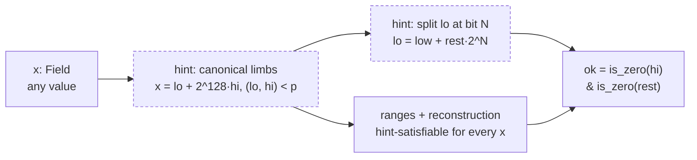

# total-noir: design

What totality means, the toolchain behaviour the library relies on, the constraint patterns it is built from, what the lint decides, and the limits. [api.md](api.md) lists the API and [limitations.md](limitations.md) the limits; [noir-coverage.md](noir-coverage.md) maps each way Noir can fail to its total replacement, and [aztec-nr-coverage.md](aztec-nr-coverage.md) does the same for aztec-nr.

## What totality means

A circuit is **existentially total** when, for every assignment of its inputs, there exists a witness satisfying every constraint, and the honest prover's hint strategy (its unconstrained functions) finds that witness.

Three boundaries of that definition matter.

- A malicious prover can still refuse to produce any witness, or run hints of its own. That is a liveness assumption about the prover, and it is separate. Totality removes the cases where even an honest prover is stuck.

- Totality says nothing about semantic correctness. A circuit that clamps garbage to zero and reports `ok = false` is total; what the caller does with the flag is design.

- Where a flag is **determined** (every satisfying witness gives it the same value), a dishonest prover cannot even lie about it. Every flag in the `total` library is determined unless its doc comment says otherwise.

Instead of asserting, a total circuit computes `ok` (and an error code), and applies

```
new_state = select(ok, f(state, inputs), state)
```

The queue advances either way; the state changes only on success.

## Classifying constraints

Not all constraints are hazards. The classification this project uses everywhere, in doc comments and in the lint:

| Class | Meaning | Verdict |
|---|---|---|
| **input-falsifiable** | Whether the constraint can be satisfied depends only on the inputs. `assert(amount > 0)`, the overflow range check on a typed addition, the range check on a typed entry parameter. | The hazard. A total circuit has none. |
| **hint-satisfiable** | The constraint restricts a prover-chosen witness (a Brillig output), and for every input the honest hint satisfies it. Booleanity of a hinted bit, reconstruction of a hinted split, `r < b` in Euclidean division with `b ≥ 1`. | Fine, and required: these are exactly the soundness constraints that stop a dishonest prover choosing a different answer. |
| **definition** | An equation the solver uses to compute a fresh witness from known ones. Hash rounds, products, sums. | Always satisfiable. |

The subtlety: a range check is not one class. On a hinted limb it is hint-satisfiable; on an input-derived value it is input-falsifiable. The class is a property of the dataflow, not of the opcode. That fact shapes both the lint and its limits.

## Verified toolchain semantics

Everything below was verified on nargo 1.0.0-rc.3 (commit 5a7ee9bf) with bb 6.0.0, by compiling probe circuits and reading the emitted ACIR, not from documentation. The probe tables are in [toolchain-semantics.md](toolchain-semantics.md).

### Branches predicate their constraints

Noir evaluates both arms of a dynamic `if`, but every probed failure source inside an arm is predicated on the branch condition: assert, assert_eq, integer overflow on `+ - *`, division and modulo by zero, array reads and writes out of bounds, `assert_max_bit_size`, short `to_le_bits`, u128 ops, user Brillig calls, embedded-curve add, MSM, and recursive proof verification. A Brillig call under a false predicate is not executed and its outputs are zeroed. So `if ok { risky }` is a legitimate totality tool when `ok` is computed totally. The library still prefers clamp-and-select: it survives refactors that lift code out of branches, and it keeps values defined on both paths.

Recursive verification (`std::verify_proof_with_type`, the RecursiveAggregation black box) is predicated in its own way, probed with a real inner proof made by bb and every case proven and verified ([recagg-probe](recagg-probe/)):

| Case | `nargo execute` | `bb prove` | `bb verify` |
|---|---|---|---|
| under `if present`, present, valid proof | ok | ok | ok |
| not present, garbage or all-zero vk and proof | ok | ok | ok |
| present, garbage, one proof field flipped, wrong public input, or wrong key hash | ok | fails | – |
| no branch (`predicate: 1`), garbage | ok | fails | – |

The ACIR carries the branch condition as the opcode's predicate. The ACVM never checks the proof, so witness generation succeeds in every case; bb honours the predicate, proving and verifying with any proof bytes when it is 0, and failing to prove when it is 1 and the proof does not verify. The failure is backend-defined, a proving failure rather than a witness failure, and a circuit whose prover can set the predicate to 0 whenever it lacks a valid proof is total. The mechanism, read from bb 6.0.0's source: a constant-0 predicate drops the opcode; a witness predicate makes bb replace every vk field, proof field and the key hash by `conditional_assign(predicate, given value, value of a dummy valid proof)`, the dummy being a valid proof and vk of a one-gate circuit bb builds at proving time, and run the recursive verifier on the result, so under 0 the given bytes are never examined. Further cases behaved the same: a predicate from a hint, two verifications under two predicates, and under predicate 0 a vk of another circuit size or a proof of the wrong type. Scope: both of bb 6.0.0's provers. The same template is instantiated for every Mega builder of the client-side prover (Chonk) that proves Aztec private functions, and a run on an Aztec 6.0.0 local network with client-side proving and the node's proof verifier on confirmed it: a private function with nothing or garbage staged under a false predicate proved and was mined, garbage or a proof for other public inputs under a true predicate failed to prove, and the real proof proved and was mined ([toolchain-semantics.md](toolchain-semantics.md), section 3).

### What is not predicated

- **Entry-point range checks.** Integer-typed and bool parameters of `main` get an unconditional RANGE in the circuit, and the ABI additionally rejects out-of-range encodings before solving. A circuit whose inputs an untrusted party chooses must take raw `Field` parameters and compute range flags itself.

- **Top-level asserts.** An assert outside any branch is the input-falsifiable constraint it looks like.

### Witness generation can die before constraints matter

Unconstrained code traps at runtime on division by zero, out-of-bounds indexing, integer overflow, and explicit asserts. A trap aborts witness generation even when every constraint would have been satisfiable. This is non-totality by another route. Library rule: each hint body states the preconditions under which it cannot trap, and every call site establishes them (divisors are selected into range before the hint call); casts inside hints truncate and never trap (verified).

### Hints may be typed; boundaries may not

Integer-typed and bool returns of unconstrained calls get a RANGE or booleanity constraint in ACIR. The honest hint is in range, so these are hint-satisfiable, and typed hint returns are good style. Typed public outputs (`-> pub u64`) emit no constraint of their own; the invariant comes from the site that produced the value. Entry parameters, and anything an untrusted party supplies, stay `Field` and go through flagging conversions.

### Casts are total and silent

Every compiling cast is total, and every lossy one is silent. `Field as u64` truncates the canonical integer value; `-1 as i8` is the cast of the Field `p - 1` and evaluates to 0 (write `-1i8`). No constraint distinguishes the lossy case, so no ACIR tool can see it. Only discipline, or a frontend check, can.

## The constraint patterns

Everything in the library reduces to a small set of gadget patterns. Each one hints a witness in unconstrained code, then pins it with constraints an honest hint always satisfies.



*`fits_bits::<N>`: both hints (dashed) are pinned by range checks and a reconstruction that exist for every Field element, so the flag is determined and the circuit never loses a witness.*

| Pattern | Hint | Pinning constraints | Why always satisfiable |
|---|---|---|---|
| Canonical limbs | 128-bit limbs of the canonical value | Two 128-bit ranges, reconstruction, borrow-compare against the modulus limbs | Canonical limbs exist and are unique for every x, including p-1 |
| Bounded split | low N bits and the rest | Ranges N and 128-N, reconstruction without wrap | Unique split exists for every value below 2^128 |
| Equality / is-zero | the inverse (or anything at 0) | x·z == 0, z defined as 1 - x·inv | Inverse exists when x ≠ 0; z = 1 works at 0; determined both ways |
| Borrow compare | the comparison bit | One range on c ? b-a-1 : a-b | Exactly one side fits the range when both operands are in width; the wrong bit wraps mod p |
| Carry split | the carry bit | Range on a+b-carry·2^N | A sum of two in-width values has exactly one valid carry |
| Wide-mul split | low and high N-bit halves of a·b | Two ranges, reconstruction (no wrap below N = 127) | The product is below 2^2N, so the split exists and is unique |
| Euclidean division | quotient and remainder | Two ranges, a == q·b1 + r, r < b1 | b1 is selected into [1, 2^N) before the hint runs; Euclid does the rest |
| Wide multiply-divide (85 ≤ N ≤ 128) | quotient limbs q = q_lo + q_hi·2^128 and remainder (bit-serial division, Field arithmetic only) | Ranges on the limbs, r and d1 - r - 1; a·b == q·d1 + r in the field; carry ranges showing a·b - q·d1 - r is a multiple of 2^128 (one carry, N ≤ 124) or of 2^192 (64-bit limbs of every operand, two carries, N ≥ 125) | The integer difference is then a multiple of p·2^K, larger than any value the ranges allow, so it is 0 and Euclid fixes (q, r); the honest carries are small integers for any in-range limbs |
| Biased signed domain | borrow/carry of the biased sum | Split of u_a + u_b + 2^(N-1); flag is the middle band | The shifted sum always splits; overflow is a flag value, not a failure |
| Residue pair (sqrt) | root r, QR bit q, and inv = 1/x (0 at x = 0) | r² == x·(g + q·(1-g)) and (1-q)·(x·inv - 1) == 0, g a fixed non-residue | For x ≠ 0 exactly one of x, g·x is a square; at x = 0, q = 1 and r = 0 satisfy both, and the second rules out q = 0 |
| Eq-scan mux | none | One equality gadget per position; sum of flags is the in-range bit | Pure selection; no memory op, no bounds predicate |
| Masked absorption | none | Select per position against a clamped length | The sponge always runs; the length only chooses contributions |

Each hinted gadget is split into a hint function and a constrain function, so the tests can feed deliberately wrong hints and watch the soundness constraints reject them. Hint bodies cannot trap on any argument their call sites can pass: that rule is what keeps witness generation alive.

## The lint

`total-lint` reads a compiled nargo artifact (a program, or each constrained function of a contract), decodes the ACIR and the debug symbols, and classifies every opcode that can fail, with its source stack. It follows the solver's order and tracks whether each witness is input-derived or hint-derived (a Brillig output).

| Class | Meaning | Exit code |
|---|---|---|
| `definition` | Solves fresh witnesses (a constant coefficient, a coefficient forced nonzero, a black box's outputs, a memory init). | no |
| `neutralised` | Predicate is constant zero, or the check is statically true. | no |
| `implied` | Can only fail if an earlier opcode failed first (a looser recheck of an established bound). | no |
| `backend-defined` | Holds at witness generation; the proving backend may fail on some inputs (ECDSA with an off-curve key). | no |
| `hint-compiler` | Touches only the compiler's own directive hints, in a pattern that holds for every input with honest hints (below). | no |
| `hint-library` | Touches a hint witness, its source is under `--lib-src`, and it is not `hint-pinned`. Each library hint carries its satisfiability argument in its doc comment. | no |
| `hint-unreviewed` | Touches a hint witness outside the library. Satisfiable only if the hint strategy is right; justify or rewrite. | yes |
| `hint-pinned` | Equates a hint-derived witness to a constant, which is how an asserted comparison or flag lowers (`assert(a < b)`), or equates a Brillig output to a constant under a branch condition computed from inputs only. Library included. | yes |
| `input-falsifiable` | Depends on input-derived witnesses only, outside the library; includes a witness-dependent division coefficient (`x / d`) and typed entry-parameter range checks. The hazard. | yes |
| `library-input-falsifiable` | The same with library provenance. Never whitelisted. | yes |
| `unsolvable` | The ACVM cannot solve the opcode. | yes |

`hint-compiler` covers three directives nargo 1.0.0-rc.3 emits for ordinary operations (`==`, casts, `&`, `/` and `%` by constants, integer comparisons, `to_le_bytes`), recognised by their exact bytecode and only when the call always runs, its inputs are linear and the divisor, radix and limb count are constants: the is-zero gadget on `directive_invert` (`E·y = 0` for `y = 1 - E·z`); the integer-quotient identity, remainder bound and quotient bound on `directive_integer_quotient`; and, on `directive_to_radix`, digit bounds and the recomposition when radix^limbs exceeds every value of the input (full width, or an input bounded by earlier range checks). RANGE checks and assertions over these outputs are decided by integer interval arithmetic, including the canonical-truncation check after `Field as uN`. The modulus comparison after a full-width `to_le_bytes` and `Field::lt` stay `hint-unreviewed`: their totality is a global argument. `--explain` lists the patterns; `src/analysis/compiler.rs` states each argument.

RecursiveAggregation is reported by the taint of its inputs, with two reasons attached: backend-defined (the solver does not check the proof; bb fails to prove when the predicate is nonzero and the proof does not verify) and the predicate it carries, named when it is a witness. The lint does not decide whether the prover can always make the predicate zero; a justification marker records that argument.

Brillig bytecode is scanned for reachable abort sites (assert or trap, division by zero, curve operations, oracle calls, short radix decompositions) and, with `--brillig-ops`, for the opcodes co-noir's MPC VM cannot execute ([co-noir.md](co-noir.md)). A reachable abort site outside the library counts like a reported item.

Two rules are specific to aztec-nr v6. A call to the PXE oracle `aztec_prv_notifyCreatedNote` whose packed note is wider than MAX_NOTE_PACKED_LEN (8 Fields in v6.0.0) is an abort site of kind `note-width`, listed beside the call's ordinary oracle site and counted in library code too: the PXE keeps such a pending note, and every later note read at its storage slot in the same transaction gets an answer wider than any reader's buffer, which the PXE refuses. The `#[note]` macro refuses such widths, so only hand-written note code emits one. The rule matches the oracle's name in the Brillig bytecode, so it sees every call, whichever wrapper or contract declares the oracle; the PXE accepts only aztec-nr's seven-argument shape (it refuses any other number of argument slots), so the packed note is always the fifth argument, and it is the only oracle that adds a pending note. And `assert(x * x == x)` (aztec-nr's `Packable` unpack of a `bool`) is `hint-compiler` only when x's honest value is in {0, 1} by how the circuit computes it (an is-zero flag, a radix digit, an earlier bound, or a combination that is 0 or 1 for every 0/1 value of at most 8 such bits); the bound the assertion itself establishes is never its own evidence. On a Brillig output, a value read from storage or a note, it is `hint-unreviewed`, because stored data can hold 2.

Exit code 0 means no reported item and no reachable abort site outside the library remains unjustified. A `// total-lint: allow <reason>` marker justifies items on its own line when it follows code, or the next statement when it sits in the comment block above it, in a file of the entry package (or under `--allow-src`); the report counts what each marker justified and lists markers that justified nothing. `--allow-entry-ranges` justifies typed entry-parameter range checks. `--baseline` accepts a recorded set of unjustified items (written by `--write-baseline`, keyed by file and source text) so only new ones fail; the Aztec `run.sh` scripts use one for aztec-nr's items.

Library provenance comes from `--lib-src` directories: relative paths resolve against the current directory, must exist, and match files by absolute path prefix. Nothing is whitelisted by default; the report lists each directory and how many files it matched.

### What it cannot decide, by construction

- **Provenance is a path.** `--lib-src` whitelists a directory's hint-class constraints and abort sites; the review of the code in it is the argument.

- **Other Noir versions.** The tool is built against the acir crates of nargo 1.0.0-rc.3 and its patterns are tested on that lowering only. It warns when an artifact comes from another version.

- **Hint-satisfiability itself.** Whether the honest hint always exists is a mathematical argument about the hint body and its constraints. The lint proves it only for the compiler-directive patterns; for the library it trusts the doc-comment arguments, checked against the compiled ACIR, per primitive, with wrong-hint tests.

- **Determinedness.** A flag forced by constraints is still hint-derived in the dataflow, and an assert on such a flag is really input-falsifiable. Equating one to a constant is reported as `hint-pinned`, in the library too. Other asserts on it (two flags compared with each other, a hint-derived branch condition, a pinned value reached through a definition under a branch) are reported as `hint-unreviewed` outside the library and whitelisted inside it, where the doc-comment arguments have to carry them.

- **Flattened branch predicates.** A predicated assert is one multiplied-through AssertZero. The lint names the factor common to every term but does not pretend to know it is a predicate. In rc.3, MemoryOp has no predicate field at all; conditions are folded into indices.

- **Markers on calls.** A marker on a call line justifies every item under the call, including items a dependency adds later; only the per-marker count shows the change. A marker inside a library (a directory under `--allow-src`, such as `noir/total_aztec/src`) justifies its items in every caller, so a library marker may only state facts that hold whatever the caller passes and whatever state exists. Where an item is acceptable only for some callers (a write-time refusal, an owner-side key request, a callee the caller chose, a recursive proof the caller supplies), the library carries no marker and each call site must justify it.

- **Baselines are not analysis.** A `--baseline` file accepts the items it lists, keyed by function, file and source text, without any argument. The Aztec `run.sh` scripts accept aztec-nr's, std's and the protocol types' items this way (each baseline holds only items in those sources); docs/aztec-nr-coverage.md and the analysis behind it classify them by hand. So a passing run means: every item outside those sources is justified, and the aztec-nr items are the ones reviewed for these contracts. A contract author writes its own baseline, so for a contract someone else wrote, "passes the lint" says nothing about the items in its baseline; read the baseline.

- **Which class wrote a slot, with which type.** The note hash has no type id, and the lint looks at one function at a time; it does not trace which code of the class creates notes at a slot and with which note type, so it cannot rule out two types at one slot, and it cannot decide whether a hand-written `NoteHash` agrees with another type's: a `compute_note_hash` can even give one value in Brillig and another in ACIR (`std::runtime::is_unconstrained`; only the ACIR branch is compiled into the circuit). The note reads in noir/total_aztec do not depend on it. They drop every note they cannot read as their own type ("Other notes at the slot" in note.nr), and the circuit finds a note only when the read request it emits names a note hash the kernel accepts ("The note hash the read request names"): the reader's note hash, computed once in the circuit, must equal the one the hint checked (for a settled note, against the PXE's settled notes), and for a pending note it must be one this call pushed. A pending note made by a hand-written `NoteHash`, a raw `notify_created_note`, or a slot written with one type and read with another therefore reads as not found, and so does every pending note created by another call of the transaction, which no oracle exposes. The lint reports the one width that still fails a reader (`note-width`). The same limit means the lint does not see a class writing public storage slots directly; the public-state reads in noir/total_aztec flag every state such writes can create.

- **Brillig liveness.** A reachable abort site is not proof that an input reaches it, and non-termination is not detected.

- **Silent truncation.** No constraint exists, so no ACIR tool can flag it.

## Oracle data and provable error codes

The library protects two parties:

- **The executor**, against circuit code that is unprovable for some input or some state. The author of the circuit is an adversary.
- **The requester** of an execution, against an executor who supplies bad witnesses to make the circuit unprovable. A witness must exist for every input, so a failure to prove is the executor's, and outputs must be fixed by the inputs, not by the executor's choice of hint.

An oracle is a hint source like any other. A circuit may use one as long as it treats the answer as untrusted data: check it with `if`, never `assert`, and report a failed check as a flag or an error code in the output. A bad answer then yields a proof of the error rather than no proof, and the bad fetch is visible to whoever reads the output.

This works under four conditions.

1. **The answer is checkable.** There is a commitment to check it against: the anchor block's tree roots, or a hash among the arguments. A note preimage with a sibling path is checkable; the contents of a capsule are not. Data with nothing behind it must be an argument.
2. **The request names what should be found.** An omission cannot be checked. "Any notes for this owner?" answered "none" is indistinguishable from a true "none"; "is this note hash in the tree?" is not.
3. **The oracle cannot abort.** An oracle that throws on absent data, or a typed return that asserts while decoding (a `bool` outside {0, 1}), stops an honest executor before any check runs. Take raw `Field`s and decode with flags.
4. **The circuit checks before a later circuit does.** A request a kernel circuit will reject (a read request for a note hash that does not exist) is an assert in another circuit. Establish the fact with a flag first, and emit the request only under it.

Two limits remain.

- **The error code does not say who is at fault.** "The path does not verify" is the same output whether the executor lied or the requester named a leaf that never existed. Where non-membership is provable (nullifiers, public data) the answer is fully determined. Where it is not (note hashes), fault is settled outside the circuit, against the public anchor block.
- **The executor chooses the anchor block.** "Not found" against an old block is honest and still steers the result. A request that cares pins a minimum block number and checks it with a flag.

The error code must also reach the requester. The return values of a private function are only hashed into the kernel's inputs, so the code has to leave in a log, a note or a public call.

## What the library cannot do

- **It cannot drop the soundness asserts.** The hint-satisfiable constraints are what pin hinted witnesses to the one honest value. Removing them makes the circuit total and meaningless.

- **It cannot make a malicious prover live.** A prover can refuse to prove, or choose hints that satisfy nothing. Determined flags close the lying channel; refusal stays a liveness assumption outside the circuit.

- **It cannot make clamping correct.** `select(ok, value, 0)` is a design decision at every call site. Totality guarantees the proof exists, not that zero was the right fallback.

- **It cannot see silent truncation.** Neither can the lint. `Field as u64` stays legal Noir, total, and wrong. The flagging conversions exist so authors never need it; nothing enforces that they use them.

- **Its guarantees are only as good as its hint arguments.** The lint whitelists the library by provenance. The claim that each library constraint is hint-satisfiable rests on the argument in each entry's doc comment, checked against the compiled ACIR with adversarial executions and wrong-hint tests. A library bug would ride the whitelist.

## Aztec: what a total private function may use

From aztec-nr v6, in a private function other users' transactions run, with this library and a clean lint:

- **May use:** `#[aztec]`, `#[external("private")]`, `#[storage]`, `Map`, `Owned`, and `#[note]` on Field-only notes, with `#[noinitcheck]` (preferably also `#[allow_phase_change]`); the `PrivateContext` getters (`this_address`, `maybe_msg_sender` as an Option, `is_static_call`, the anchor header); pushes (note hashes, nullifiers, logs, enqueued public calls) whose count is a compile-time constant within the per-call limits and that are skipped under a static call; `public_storage_historical_read`; `random()` where its value need not be fixed for the requester.
- **Only through noir/total_aztec:** note reads (`get_note_or`, `get_notes_or`; `found` is the executor's choice, and a pending note is found only in the call that created it), a settled note or note hash from a caller-held witness (determined), nullifier and initialisation flags, an initializer's arguments in a later call of its own transaction (checked against the address), `PublicImmutable` and `DelayedPublicMutable` reads (determined; no `bool` members), key decoding, a static call into a class the caller trusts (`static_call_flagged_or`), and consuming another owner's note with that owner's proof (`consume_with_nullification_proof_or`).
- **May not use:** aztec-nr's state-variable getters and writers beyond those wrapped (they assert, `expect`, or need the owner's nullifier key); note getters; key validation requests (`request_nhk_app`, `request_ovsk_app`; the oracle throws for anyone but the scoped owner and only the kernel checks the request); `get_public_keys` for an argument address; authwit (`getAuthWitness` throws, `#[authorize_once]` adds a nested call); `#[initializer]`, `#[view]`, `#[only_self]` and `self.msg_sender()` (a first call has no sender); nested private calls into a class the author does not control; aztec-nr's note delivery on the onchain modes (wallet tagging state can throw); capsules (an unchecked, abortable read); `consume_l1_to_l2_message`, `get_block_header_at`; typed (non-Field) parameters on functions other contracts call.

What no library can fix, because the protocol decides it: a private call cannot be caught, so any callee failure fails the caller; read requests, key validation requests, nullifier-to-note links and static-call emptiness are checked only by kernel circuits, with no flag form; nullifier uniqueness is enforced only at inclusion, so a nullifier landing after the anchor block makes a proven transaction drop; the per-transaction limits are shared with every other call; the expiration window is checked at inclusion; note non-existence has no proof; the executor chooses the anchor block; and a callee's `sync_state` runs in the caller's PXE outside every circuit.

## Author checklist

For a circuit that must be total.

1. Inputs an untrusted party controls are `Field` (or arrays of Field), never typed parameters. Convert with flagging conversions and fold the flags into an `Outcome`.

2. No `assert` except a deliberate boundary assert at a trust boundary that exists to refuse (an account entrypoint guarding its own owner's transaction). Pattern: total core, one boundary assert on the final `ok`.

3. No native integer arithmetic on values an input can drive to a boundary. Use the flagged (`_or`), wrapping, or saturating forms with declared widths, and select on the flags.

4. No native casts in the circuit body. Use the flagging conversions; if you truncate, take the form that returns the dropped part.

5. No `arr[i]` with a witness index. Use `index_or` / `set_or`.

6. Division, modulo, inversion, and square roots only through the flagged forms.

7. Reads of state someone else controls are flagged (`get_note_or` pattern): compute `found`, mask the value, and emit existence requests only under `found`.

8. Hint functions you write cannot trap on any argument they can receive, and their outputs are pinned by constraints that an honest hint always satisfies. Follow the hint/constrain split so wrong-hint tests exist.

9. Branches may guard risky ops only when the condition is computed totally; prefer clamp-and-select anyway.

10. If co-noir will extend the witness: no `sqrt_or`, `sqrt_canonical_or`, `sha256_var_or`, `keccak256_var_or` or ECDSA entries; no integer shifts, bitwise ops, ConditionalMov or black boxes other than ToRadix (hashes, curve operations) in your own hints, a clean `total-lint --brillig-ops`, and one real co-noir run ([co-noir.md](co-noir.md)).

11. Run `total-lint` on the compiled artifact. Zero unjustified items. Every `total-lint: allow` marker carries a reason a reviewer would accept.

12. Execute the circuit on adversarial inputs: zeros, maxima, boundary values, garbage encodings. Every execution must produce a witness, with `ok = false` and defined outputs.

13. In an Aztec contract function other users' transactions run: no asserting getter, no macro init check (`#[noinitcheck]` plus a flag), Field-only notes decoded with flags, keys refused where they are written and flagged where they are read (the `total_aztec` entries); as a caller, read a callee's returns as Fields and call it statically.

14. Remember what the tools cannot check: totality claims rest on the hint arguments checked against the ACIR, and silent truncation is invisible. If you bypass the library, you own those arguments.

